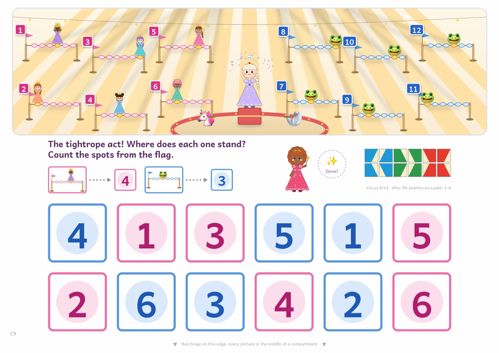
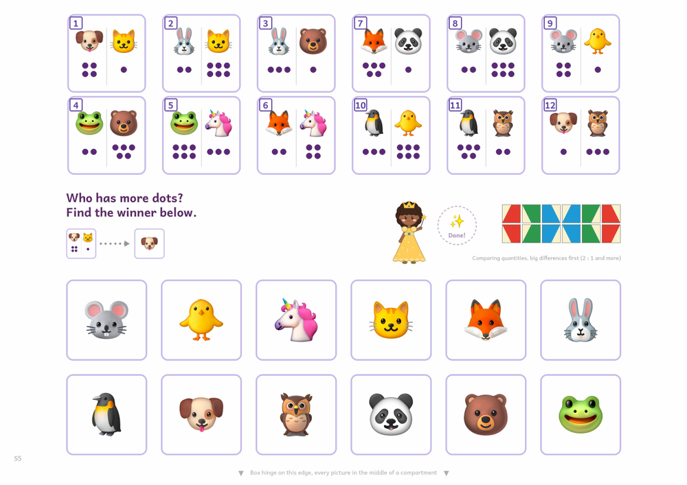
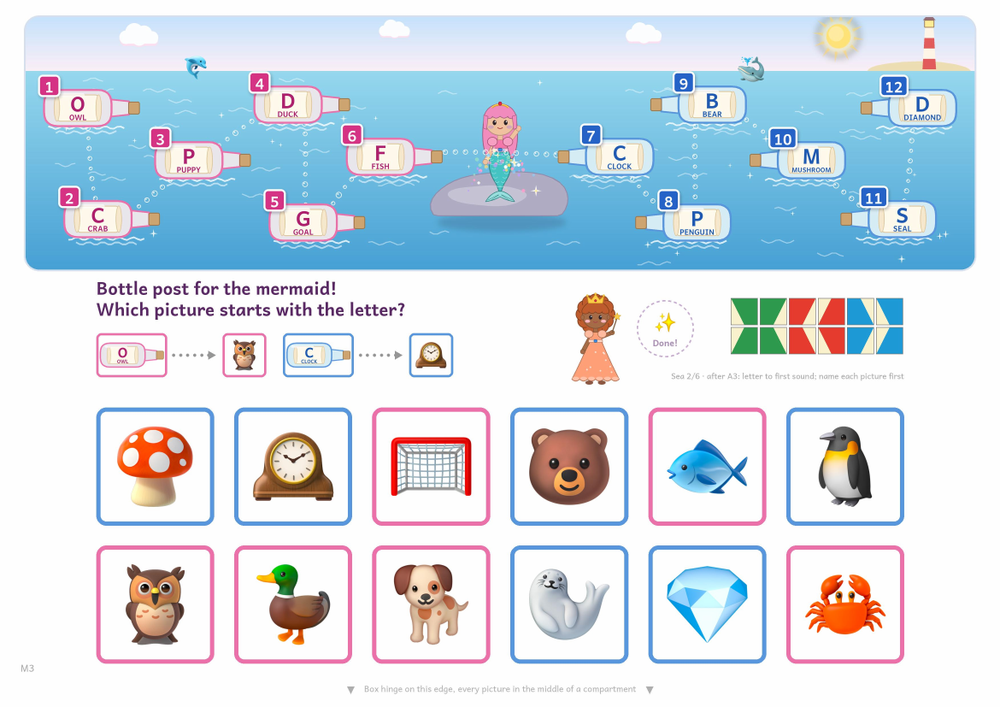
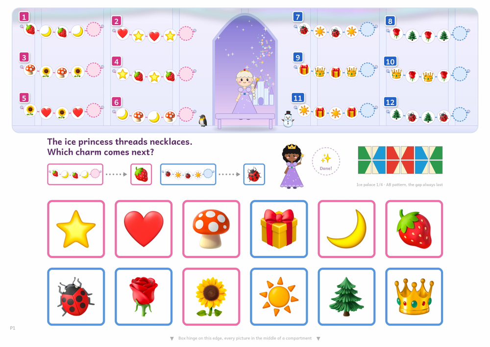

# miniluek-sheets

Printable A4 worksheets for the **miniLÜK** control box, with control patterns that work.
An agent skill and a small Python generator: write 12 tasks per sheet as JSON, get a PDF.

Three lanes ship ready to print, each in English and German, one story per lane. Numbers and
letters pair plain sheets that teach with picture sheets that review; logic is picture sheets only:

| Lane | Sheets | Story | English | Deutsch |
|---|---|---|---|---|
| Numbers | 13 plain (S1–S13) and 14 circus sheets | a day at the unicorn circus | [numbers-en.pdf](https://github.com/micuintus/miniluek-sheets/releases/latest/download/numbers-en.pdf) | [zahlen-de.pdf](https://github.com/micuintus/miniluek-sheets/releases/latest/download/zahlen-de.pdf) |
| Letters | 6 plain (A1–A6) and 6 sea-post sheets | the mermaid's sea post | [letters-en.pdf](https://github.com/micuintus/miniluek-sheets/releases/latest/download/letters-en.pdf) | [buchstaben-de.pdf](https://github.com/micuintus/miniluek-sheets/releases/latest/download/buchstaben-de.pdf) |
| Logic | 4 sheets | the ice palace | [logic-en.pdf](https://github.com/micuintus/miniluek-sheets/releases/latest/download/logic-en.pdf) | [logik-de.pdf](https://github.com/micuintus/miniluek-sheets/releases/latest/download/logik-de.pdf) |



The numbers lane runs small sets 1–3, counting to 6, dice and finger patterns, comparing, numerals
both ways, scattered sets, a number path, comparing by counting and comparing numbers, then
ten-frame and "one more". The core order follows the What Works Clearinghouse practice guide,
every step, sheet and rule mapped to its study ([research](miniluek-sheets/presets/numbers/research.md)).
Each plain sheet S*n* is reviewed a week later by its circus sheet C*n*; C14, the party after
the show, adds take-away. The German finger pictures count from the thumb, the English ones from
the index finger (`--fingers` switches).

The letters lane teaches letters, first sounds, word beginnings and short printed words; M2 reviews A2
the other way round, M3–M6 review A3–A6 with new words, and M7 reads words in the reverse direction. A1
has no revisit. It
borrows the literacy-precursor evidence without the numbers lane's tight mapping
([research](miniluek-sheets/presets/letters/research.md)). Until the number sheets are
mastered, they keep five days a week and a letters or logic sheet takes the other two, so one
sheet a day stays the cap.

The logic lane has four sheets with no plain sheet before them: AB patterns, the same shape in
another colour and size, odd one out, the same place on a map. Each comes after the same idea
with objects ([research](miniluek-sheets/presets/logic/research.md)).

Each sheet runs one direction, no answer is a copy of another task, pink and blue families halve
the search on the two-pair sheets, and every page prints its sheet id at the lower left.

| | |
|---|---|
|  |  |
|  | |

## Install

**Pi:**
```bash
pi install git:github.com/micuintus/miniluek-sheets
```

**Other agents:** copy the `miniluek-sheets/` directory into your agent's skills folder. It
needs Python 3.9+ and Pillow (`pip install pillow`).

## Use

```bash
cd miniluek-sheets
python3 scripts/miniluek.py build presets/numbers/numbers.json -o numbers.pdf
python3 scripts/miniluek.py build presets/numbers/zahlen.json -o zahlen.pdf
python3 scripts/miniluek.py build presets/letters/letters.json -o letters.pdf
python3 scripts/miniluek.py build presets/logic/logic.json -o logic.pdf
python3 scripts/miniluek.py fit-test -o fit.pdf          # --language de for German labels
```

Print landscape at **100 % / actual size**. Open the box and lay the clear lid on the sheet with
the hinge on the lower paper edge: every picture sits in one compartment. Tile 1 goes on the
answer to task 1, and so on. Close, turn over, open, compare with the printed pattern.

Or ask your agent: "make miniLÜK sheets: dice and numbers 1–6, with unicorns".

## Your own sets

Copy a preset, edit titles and tasks, then `python3 scripts/miniluek.py check your-set.json`.
Matching (one or two colour families), "one more", same-thing and comparing sheets (dots or
numerals) are supported; pictures include drawn
princesses, finger patterns, dice, numerals, a ten-frame, a number path and 99 emoji.
Format and picture scenes: [spec](miniluek-sheets/references/spec.md).

## How it works

- Geometry: compartment pitch 4.10 cm, measured and checked on a real box.
- Control patterns: the twelve tile backs (three colours, a cream triangle in one of four
  corners) were mapped from published example exercises and checked on the box. Every pattern
  in the library uses each tile once and is symmetric. Details: [format](miniluek-sheets/references/format.md).
- Order and sources per lane: `teaching-order.md` and `research.md` in [numbers](miniluek-sheets/presets/numbers/), [letters](miniluek-sheets/presets/letters/) and [logic](miniluek-sheets/presets/logic/).

## Credits and licences

Code and the drawn princesses and hands: MIT ([LICENSE](LICENSE)). Emoji: Noto Emoji by Google,
SIL Open Font License 1.1. Font: Andika by SIL International, SIL Open Font License 1.1.
Sources and licence texts: [NOTICE](NOTICE.md).

Not affiliated with Westermann. miniLÜK and LÜK are trademarks of Westermann; the box and the
original booklets are sold by them.
